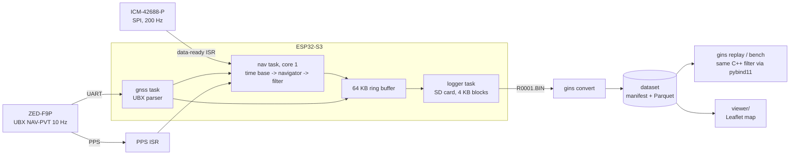

# GNSS/INS Dead Reckoning Logger

A bike-mounted navigation logger. An ESP32-S3 reads an ICM-42688-P IMU at 200 Hz and a u-blox ZED-F9P GNSS receiver at 10 Hz. It timestamps both against the receiver's PPS pulse and runs a loosely coupled error-state Kalman filter in C++ on FreeRTOS, so the position track keeps going through GNSS outages (tunnels, overpasses, downtown towers). Every raw sample goes to the SD card. Python tools turn the logs into a ride dataset, replay each ride through the same C++ filter, and measure drift during simulated outages against an RTK reference.

Why: my GPS track jumped a block every time I rode downtown, so I built the fix a real navigation system uses: an IMU and a Kalman filter that carry the position through the gaps.

> **Status:** the code is complete and tested on the host and in CI, and the firmware builds for the ESP32-S3. It hasn't been run on hardware yet. See [docs/bringup.md](docs/bringup.md) for the bench steps and [docs/results.md](docs/results.md) for which numbers are measured and which are simulated.

## How it fits together



- **`core/`** is the shared C++17 code: error-state Kalman filter, navigator (alignment, fixed-lag time ordering, outage handling), PPS time base, UBX parser and log format. It builds in float for the ESP32 and in double for the host, with no heap use (Eigen fixed-size matrices).
- **`firmware/`** is the ESP-IDF 5.2 app: IMU and GNSS drivers, PPS capture, the SD ring-buffer logger and a JSON shell over USB.
- **`tools/`** is the `gins` Python package: convert, replay, outage benchmark, GeoJSON export and synthetic rides for testing.
- **`viewer/`** is a static HTML/CSS/JavaScript map that compares GNSS-only, fused and reference tracks.

## The filter in one paragraph

The nominal state is position and velocity in a local north-east-down frame, attitude as a quaternion, and accelerometer and gyro biases. The 15-element error state is propagated with every IMU sample. GNSS position and velocity fixes correct it through a chi-square innovation gate. Ten rejected fixes in a row force a reset with inflated covariance, so the filter can't lock itself out after a long outage. Two pseudo-measurements carry it through outages:
- **Bike motion constraint:** a bike doesn't slide sideways or move vertically in its own frame. This makes heading error observable without GNSS.
- **Zero velocity and zero angular rate updates:** applied while stopped at a light, to pin the velocity and the gyro bias.

Fixes arrive 20 to 60 ms after their epoch, so the navigator holds IMU samples for 100 ms and applies each fix at its exact epoch time.

## Build and test

Host (needs CMake, a C++17 compiler, Eigen 3.4 and GoogleTest; on Ubuntu `sudo apt install libeigen3-dev libgtest-dev`):

```sh
cmake -S . -B build -DCMAKE_BUILD_TYPE=Release
cmake --build build -j
ctest --test-dir build --output-on-failure
# same tests in single precision, as the ESP32 runs them
cmake -S . -B build_float -DGINS_USE_FLOAT=ON && cmake --build build_float -j && ctest --test-dir build_float
```

Python tools:

```sh
pip install "./tools[test]"
python -m pytest tools/tests
```

Firmware (ESP-IDF 5.2.2, Eigen headers at `/usr/include/eigen3` or `EIGEN3_INCLUDE_DIR`):

```sh
cd firmware
idf.py set-target esp32s3
idf.py menuconfig      # GNSS/INS logger -> pins, mounting rotation
idf.py build flash monitor
```

## Using it

```sh
# copy R0001.BIN off the card, then
gins convert R0001.BIN --dataset dataset --ride-id 2026-12-04_commute --tags downtown
gins replay dataset/rides/2026-12-04_commute --mask 600:20 --out fused.parquet
gins bench --dataset dataset --lengths 10 20 30 --per-ride 20 --markdown docs/results_rides.md
gins export dataset/rides/2026-12-04_commute --out viewer/ride.geojson --mask 600:20
```

Open `viewer/index.html` and load the GeoJSON. `gins synth` writes a synthetic ride log if you want to try the tools without hardware. `viewer/demo.geojson` is one of those synthetic rides.

Shell commands over USB (one JSON line per reply): `status`, `pose`, `log start`, `log stop`, `mask gnss <s>` (a live outage test), `cal static`, `version`.

## Hardware

ESP32-S3-DevKitC-1, ZED-F9P board with a multi-band antenna, ICM-42688-P breakout and a microSD breakout. Default pins are in `firmware/main/Kconfig.projbuild`. Mount the IMU to the frame, not the handlebars, and set the mounting rotation in menuconfig. Wiring and bring-up: [docs/bringup.md](docs/bringup.md). Design notes: [docs/design.md](docs/design.md).

## License

MIT
